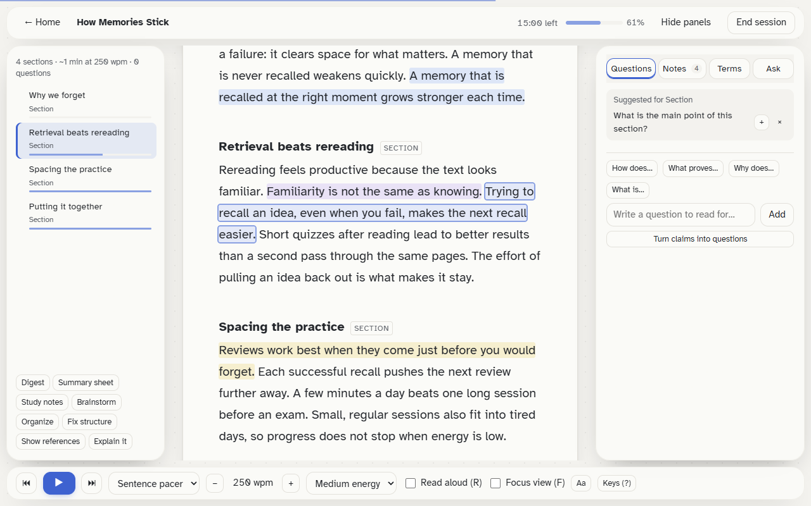
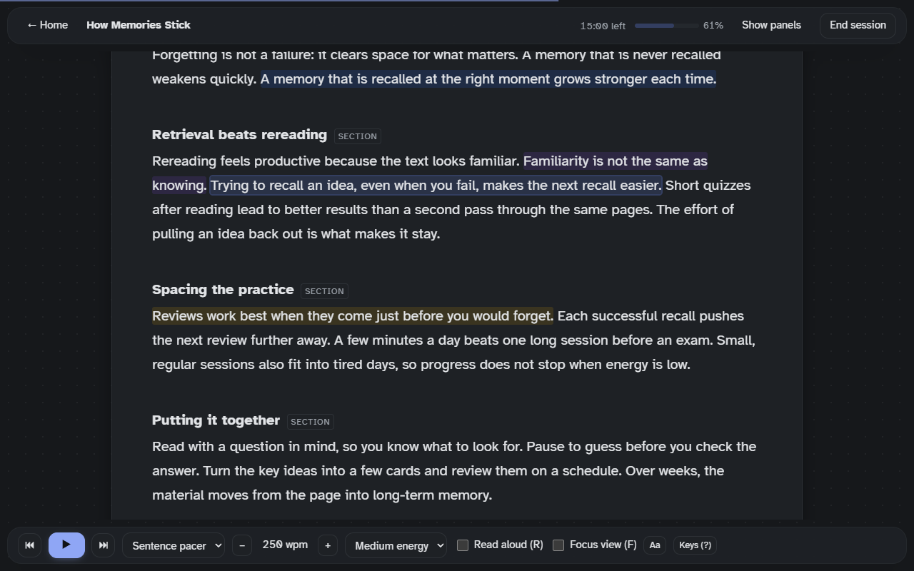
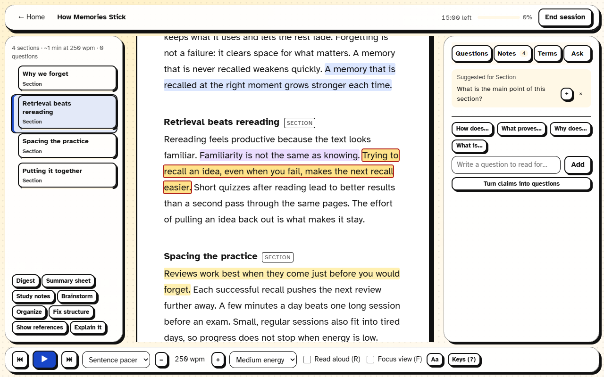
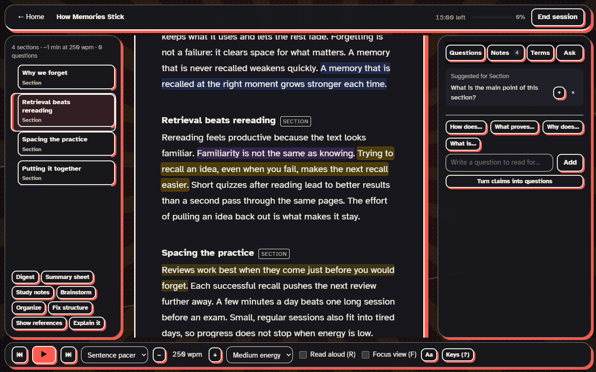
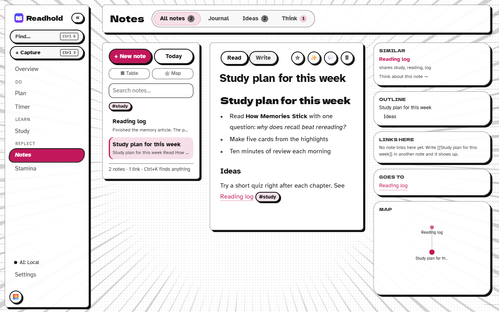
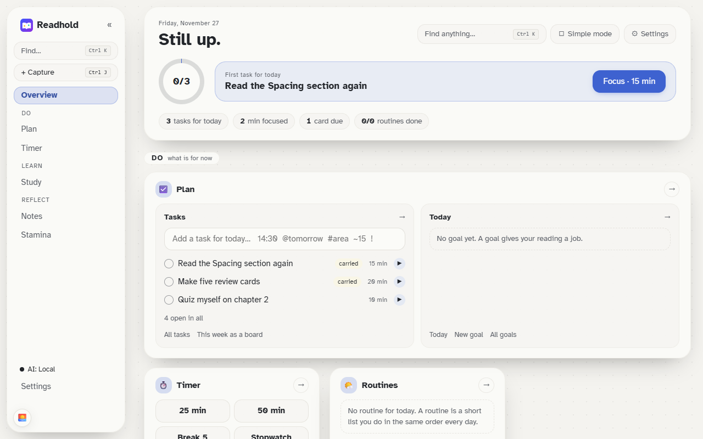
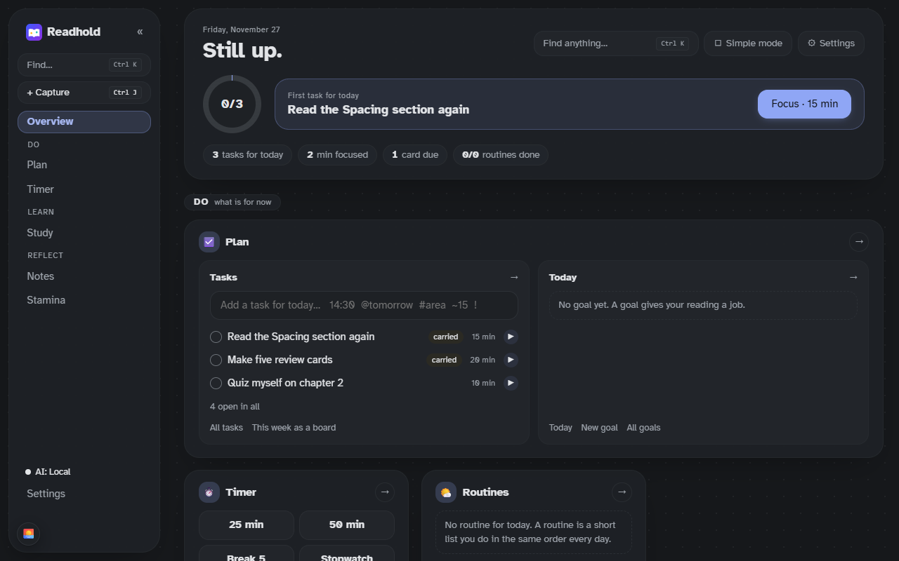

# Readhold

**A local-first reader for papers, articles and notes that helps you actually understand and remember what you read.**

Readhold shows a text's shape before its detail, gives you a question to read for, paces you sentence by sentence
(slower on dense sentences, faster on easy ones), and turns your highlights into notes and review cards. Everything
stays on your computer: no account, no telemetry, no server of ours. An optional AI assistant runs on a model on your own
machine (or a cloud model with your own key) and is off until you switch it on.

| | |
|---|---|
|  |  |
| **Clean**, the theme Readhold starts with: calm, minimal, easy on the eyes | Clean in dark mode, with the side panels hidden (**Hide panels** or `Ctrl+\`) |



| | |
|---|---|
|  |  |
| The same reader on a black cover (Comics: Classic Action) | Notes with links, an outline and a map (Comics: Manga Action) |

| | |
|---|---|
|  |  |
| The Overview: today's first task, focus timer and routines (Clean) | The same Overview in dark mode |

## Highlights

- **Map before the wall.** Every document opens with its sections, length and suggested questions before the text.
- **Read with a job.** Pick a question first; the pacer moves one sentence at a time and slows on dense ones.
- **Attempt before reveal.** Guess before you look, recall before you move on; highlights become review cards (FSRS).
- **Low days still count.** Energy modes and short time boxes make a tired 10-minute session real progress.
- **AI as a plug-in, never a dependency.** Twelve optional features (ask a document, ask your library, study notes,
  brainstorm, tidy, plan and note chats…). Each has a version without AI, checks every quote against the text, and
  changes nothing without your click, with Undo. Private items never leave your computer.
- **Themes, calm or loud.** Eighteen themes: **Clean** (the default, calm and minimal), plain paper, calm scenes (a
  meadow, a solar system) and three comics themes, each with a light and a dark look;
  reading text always stays on a solid, high-contrast page (WCAG AA, tested).
- **Never lose work.** Every keystroke is saved as you go (SQLite, WAL), with daily backups and a resume point.

## Run it

```bash
uv sync                                   # once: Python dependencies (pinned in uv.lock)
cd web && npm ci && npm run build && cd ..   # once: builds the front end (needs Node.js)
uv run python -m readhold                 # opens the desktop window
```

You need [uv](https://docs.astral.sh/uv/) and [Node.js](https://nodejs.org/). The front-end bundle is not stored in the repository,
so the window stays empty until `npm run build` has run once.

**Windows, macOS and Linux.** The same three commands work on each (on macOS and Linux, in Terminal). Developed on
Windows; CI runs every test on Windows, macOS and Linux. On macOS, PDF import needs macOS 13 or newer. On Linux the
desktop window needs the system's GTK or Qt WebKit packages; without them, `--browser` opens Readhold in your browser.

Other ways: `uv run python -m readhold --browser` (default browser). On Windows you can also double-click `Readhold.pyw`,
or create a desktop shortcut: `powershell -ExecutionPolicy Bypass -File scripts\make_shortcut.ps1`.

After editing `web/src`, run `cd web && npm run build` again.

**New here?** Start with [**Readhold in 15 minutes**](docs/QUICKSTART.md), a short tour of the app.

## Use it
1. **Study → Documents** → drop a PDF, Markdown, text or code file, or paste text. For a web article or an arXiv paper, save it as a PDF first.
2. **Read** → 5-second setup (energy, time box, one question). `Space` plays the pacer. Papers start in **Pass 1**.
3. While reading: `1–5` highlight (claim, evidence, definition, confusing, idea), `Q`+number tags a paragraph to a question,
   select a word + `G` for the guess gate, `N` margin note, `I` idea, `B` back-jump, `W` pacer mode, `R` read aloud, `?` all keys.
4. **End session** asks for one next-step sentence — that's what Today shows tomorrow.
5. **Review** daily (~5 min, capped). **Summary** builds your notes sheet; export to Markdown for Obsidian.

## Where things live
`data/readhold.db` (SQLite), `data/backups/` (daily, 14 kept), `data/exports/`, `data/logs/readhold.log`, `library/` (original files).
All git-ignored: nothing you read or write is ever part of the repository.

## Get started with AI (optional, 5 minutes)

Readhold works fully without AI. To add the assistant with a model that runs on your own computer, so nothing leaves it:

1. **Install Ollama**, a free app that runs models on your computer: [ollama.com](https://ollama.com).
2. **Download a model.** In a terminal: `ollama pull llama3.2` (about 2 GB; a bigger model such as `qwen2.5:7b` gives better answers with 16 GB of memory or more).
3. **Connect Readhold.** **Settings → AI** → **Local model**, server **Ollama**, model `llama3.2`, then **Test connection**: it should say the model answered.
4. **Try it.** Select a passage in the reader and press **Explain**, or press **💬** in a note and ask the model to format it, enhance it or write an idea.

A cloud model (Anthropic or OpenAI) works too, with your own API key: choose **Cloud model** in Settings → AI. Details: [the guide, *Settings → AI*](docs/GUIDE.md).

## Privacy
Readhold connects to nothing by itself. The server listens only on `127.0.0.1`, on a random port, behind a session token. There is no telemetry and no account.

The only connection Readhold can make is to the AI model you chose in **Settings → AI**, and only while AI is switched on. AI is off by default. The default is a model server on your own computer (Ollama, llama.cpp, LM Studio). A cloud model needs your own API key, which is kept in the operating system's credential store (Windows Credential Manager, the macOS Keychain, or the Secret Service on Linux), never in a file, the database or a log. In cloud mode the text an AI call works on is sent to the provider you chose; nothing else is.

Privacy controls, in **Settings → AI**:
- **Private items.** Tag a document or a note `#private` (Organize has a **Private** box) and it is never sent off this computer, and neither are your own notes that copy its sentences or name it. A local model still reads it. Or turn it round: send only what you tagged `#cloud`.
- **Show what will be sent.** Before a call leaves this computer you see the exact text, and it is sent only when you press **Send**.
- **Retention, export, clear.** The AI log is kept 30, 7 or 1 days and is never exported. **Export everything** holds the results a model wrote that Readhold kept; **Clear AI history** deletes them and the log, and keeps what you kept from a model (cards, notes).
- Before any call that leaves this computer, secrets (keys, passwords, e-mail addresses, phone numbers) are replaced by `[redacted]`. A "local" model server on another computer gets the same rules as a cloud model.

`tests/test_no_network.py` keeps it that way: only the LLM adapters in `readhold/ai/` may import a network client.

What Readhold protects against, and how that was checked before it was published: the threat model in
[`docs/ai/PLAN.md`](docs/ai/PLAN.md), section 6.1a.

## Docs
Quick start: [`docs/QUICKSTART.md`](docs/QUICKSTART.md). User guide: `docs/GUIDE.md`. Code guidebook: `docs/CODE_GUIDE.md`. Phase status: `docs/PHASES.md`.
AI assistant plan: `docs/ai/PLAN.md`. Built so far: Phase 0 (foundations, no AI), all of Phase 1, milestones 1.1 to 1.5, of Phase 2 milestones 2.1 (quote checks), 2.2, 2.3 and 2.4, all of Phase 3, milestones 3.1, 3.2 and 3.3, all of Phase 4: 4.1, the evaluation harness, 4.2, "Why did it say this?", 4.3, the red-team suite in CI, 4.4, the privacy controls, and 4.5, the security review; and all of Phase 5 ("Everyday control"): 5.1, delete on everything (no AI), 5.2, Tidy, and 5.3, Plan chat, with 5.4, Note chat, added on request. That is the connection (the LLM port, key storage, the AI log, the off switch), the guardrails, and twelve AI features. All are off until you switch AI on in **Settings → AI**, and each asks the model only when you press its button:
- **Recap with AI**: when you reopen a document, "Where you left off" shows what you read last time (no model needed); the button adds a three-line recap written from those passages.
- **Explain**: select a passage in the reader, pick a level (simple, student, expert), write your own take first if you like, and get an explanation built from the passage and its paragraph only. You can save it as a margin note, labelled as the model's until you edit it.
- **Digest**: the reader's **Digest** button shows a document's outline and reading time (no model needed); **Digest with AI** adds a summary, key ideas with checked quotes, keywords and a guessed difficulty, written part by part in the background (one section-sized part per call, references left out) with progress and Stop.
- **Ask**: the reader's **Ask** tab finds the passages of the document that match your question (no model needed); with AI on, the model answers from the best-matching sections only, with ✓ quotes that jump to the sentence, or says "Not found in this document".
- **Ask your library**: a box on the Documents tab finds the passages and notes across your whole library that match a question (no model needed); with AI on, the model starts from them, may search again or read more of one source (at most 3 steps, with Stop), and answers with ✓ quotes that open the sentence or the note, or says "Not found in your library". In cloud mode files of secrets and private items are left out.
- **Study notes**: the reader's **Study notes** button points to the summary sheet (no model needed); with AI on, **Write** drafts a quiz, flashcards or notes from your highlights or one section, each item resting on a ✓ quote in the document's own words. Nothing is saved until you keep items: notes go to a labelled note with links back, cards to Review, marked as the model's, each only once.
- **Plan my reading**: on Plan → Tasks, tick documents, put them in order, pick how hard each one is, your minutes a day and a deadline; Readhold spreads what is left over your days (no model needed), never past your minutes or the deadline, names what does not fit, and adds the plan as tasks you can take back in one step. With AI on, a model can suggest the order and levels from each document's size, titles and opening; each reason has a ✓ quote or is labelled a guess, and nothing changes until you use it.
- **Brainstorm**: the brainstorm sheet of a note or an idea (Notes → Think) asks you questions first and then shows what is near it in your notes and reading (no model needed). With AI on, **Ideas from the model** writes ideas from three angles (connections, questions, uses), and a second call groups the ones that say the same thing and ranks them. The reader's **Brainstorm** button does the same from a document's highlights, after you write one line of your own. Only ideas that rest on a passage of yours, checked word for word, count: they go straight into the sheet, each as its own section, for you to edit or delete, with Undo.
- **Organize**: give a document tags of your own; each tag is also a collection, a chip on the Documents tab that shows only its documents. The **Organize** box (on each document in the queue, and in the reader) lists related documents by the words they share and suggests tags you already use (no model needed). With AI on, a model suggests tags (yours first, at most two new ones) and related documents from that list; a tag's ✓ quote is checked, and nothing changes until you add a tag, with Undo.
- **Tidy**: **✨ Tidy tasks** on Plan → Tasks says what each task lacks (a verb first, one outcome, a day, a short text) and offers fixes code is sure of, such as "30 min" or "tomorrow" written in the text moved into the task's minutes and day (no model needed). A ✨ on a routine and on a note tidies spacing and lists the same way. With AI on, a model proposes a rewrite or a split; every word you did not write is shown marked, your own links, tags and properties are kept, and nothing changes until you press **Use**, with Undo.
- **Plan chat**: **💬 Plan with a model** on Plan → Tasks. Say what you need ("plan my week around the exam on Friday"); the model reads your next 14 days with their free minutes, your open tasks and your reading deadlines, and drafts at most 12 tasks. Each draft is checked (a real day, possible minutes, your free time that day, not a task you already have). Nothing is added until you press **Add**; each click can be undone, and each task's note says a model drafted it.
- **Note chat**: **💬** in a note's bar, next to ✨. Say what you want done with the note ("make it more formatted", "enhance it", "write an idea for a story"); the model reads the note and the conversation, replies, and proposes the whole note rewritten (checked like Tidy's: your links, tags and properties kept, new words marked) or text for the end of the note. Nothing changes until you press **Use this** or **Add to the note**, with Undo. Without AI, ✨ Tidy and your own writing do the job.

Every AI text has a **Why did it say this?** link beside its label. It opens a panel with each model call behind the text (model, prompt version, time, tokens, outcome, the checks the guards ran), the sources each call was sent, named but never shown again, and the prompt word for word. It reads the AI log on this computer and calls no model. **Delete this result** in that panel removes one AI result, with Undo.

**Delete and Undo everywhere** (no AI): review cards, habits, goals, map links, journal pages, letters, side goals, energy check-ins, focus sessions and single AI results can each be deleted, and the toast's **Undo** brings them back with what hangs on them (a focus session's minutes, a journal page's drawing).

None of the twelve has been checked against a real model yet; all were tested with a stand-in.

## Tests
`uv run pytest` — parsers (PDF, Markdown, text, code files), sentence splitting, density, terms/acronyms, FSRS cards, API security, migrations, the full-text index of sections, theme contrast, the AI port, the guardrails, the reading plan's scheduler, document tags and related documents, delete and Undo on every kind of record, Tidy's hints and fixes, and the twelve AI features (with a fake model server: no test reaches a real one), the privacy controls and the security fixes. 920 tests on 2026-11-26 (918 pass, 2 skipped).
Add your own files to `tests/fixtures/real/` and they're tested automatically.

**Red-team suite.** `tests/test_redteam.py` runs every attack of section 6.9 of the AI plan end to end (hidden orders in a PDF, an exfiltration image link, a key in a code file, invented quotes and anchors, raw HTML, a huge document, a question with no answer, a loop that keeps searching, a private document in cloud mode); each must fail safely. **CI** (`.github/workflows/ci.yml`) runs it first on every push and pull request, on Windows, macOS and Linux, then all tests, then the front-end build. It needs no secrets. Each action is pinned to a release's full commit SHA.

To measure the AI features with your model: `uv run python -m readhold.eval` runs all twelve over a fixed set of sample texts, in a throwaway folder, and prints one table of scores (a cloud model needs `--yes`). `--stand-in` runs it on a fake model, to check the harness itself.

## License

Readhold is released under the [MIT License](LICENSE). The bundled fonts (SIL Open Font License) and KaTeX (MIT)
keep their own licences: see [`THIRD_PARTY_NOTICES.md`](THIRD_PARTY_NOTICES.md).
